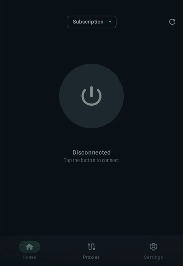
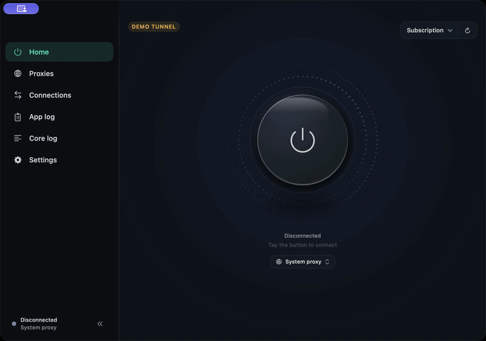
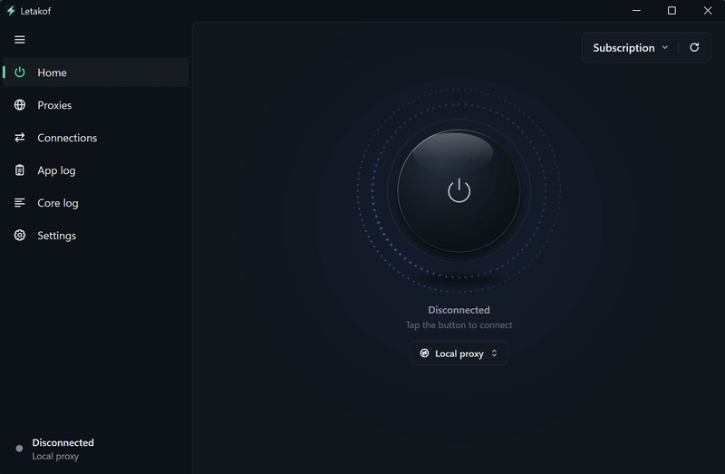

  

<h1 align="center">Letakof</h1>

VPN and proxy client powered by <strong>Mihomo</strong>.

Preliminary version for Android, macOS and Windows.

<strong>English</strong> · <a href="README.ru.md">Русский</a> · <a href="README.zh-CN.md">简体中文</a>

  <a href="https://letakof.app/en/">Website</a> ·
  <a href="https://letakof.app/en/docs/">Documentation</a> ·
  <a href="https://github.com/dorian6996/Letakof/releases">Releases</a> ·
  <a href="https://github.com/dorian6996/Letakof/issues/new">Report a bug</a>

## Features

- Clash/Mihomo YAML subscriptions, profile updates and HWID support. Traffic allowance, expiration date and provider announcements.
- Subscription and proxy key management: add individual keys to a subscription or use them without one.
- Proxy groups with latency testing, automatic server selection, fallback and load balancing.
- TUN, system proxy and local HTTP/SOCKS5 proxy modes. Password-protected proxy access for devices on the local network.
- Network scenarios that select the operating mode and subscription based on the network type on macOS and Android.
- Whitelist mode, when enabled by the provider.
- View, enable, disable and reorder subscription rules. Edit custom rules for domains, IP addresses, subnets and ports, with changes preserved when a subscription updates.
- Routing presets, custom rule sets and proxy groups.
- DNS servers by role, fake-IP exclusions, IPv6 settings and GEO database updates.
- TUN stack selection and QUIC (HTTP/3) controls.
- Back up settings and profiles, and restore them from a file.
- [HTTP subscription headers](https://letakof.app/en/docs/http-headers/additional-headers/) for provider links, traffic and expiry notices, and interface restrictions.
- Connection inspection with matched rules, proxy chains and core logs.
- Interface languages: English, Russian, Simplified Chinese, Traditional Chinese, Vietnamese, French and Spanish.

## Protocols

Mihomo supports VLESS, VMess, Trojan, Shadowsocks, Hysteria, Hysteria2, TUIC, WireGuard, AnyTLS, SOCKS5 and HTTP, among other protocols. Available servers and their transport settings depend on the subscription.

Subscriptions use the Clash/Mihomo YAML format.

## Demo

Connecting and opening proxy groups. The “Subscription” profile, servers named after countries and traffic data are simulated.

<table>
  <tr><th>Android</th><th>macOS</th><th>Windows</th></tr>
  <tr>
    <td valign="top" align="center"></td>
    <td valign="top" align="center"></td>
    <td valign="top" align="center"></td>
  </tr>
</table>

## Releases and bug reports

Builds and version notes are published in [Releases](https://github.com/dorian6996/Letakof/releases).

Submit bug reports and feature requests in [Issues](https://github.com/dorian6996/Letakof/issues). Include the app version, OS version and steps to reproduce the issue.

Letakof is proprietary software. This repository is used for releases and bug reports and contains only documentation and repository assets. Application source code is not published here.

