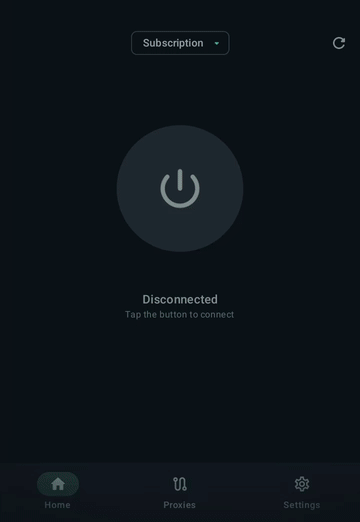
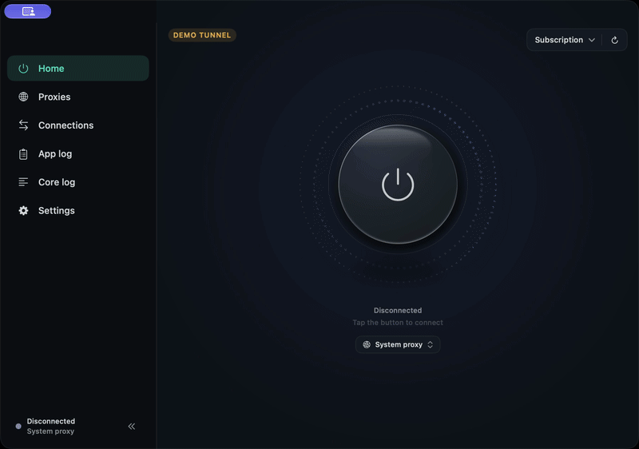
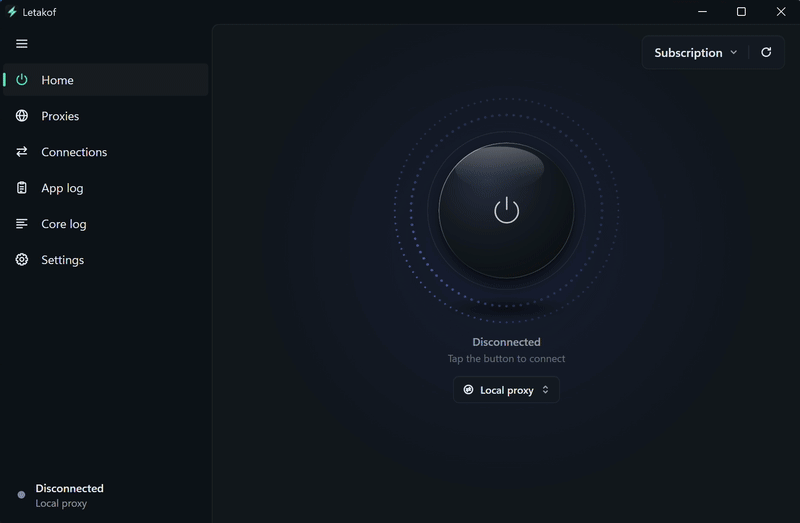

  

<h1 align="center">Letakof</h1>

基于 <strong>Mihomo</strong> 内核的 VPN 和代理客户端。

适用于 Android、macOS 和 Windows 的预览版本。

<a href="README.md">English</a> · <a href="README.ru.md">Русский</a> · <strong>简体中文</strong>

  <a href="https://letakof.app/en/">网站（英文）</a> ·
  <a href="https://letakof.app/en/docs/">文档（英文）</a> ·
  <a href="https://github.com/dorian6996/Letakof/releases">发行版本</a> ·
  <a href="https://github.com/dorian6996/Letakof/issues/new">报告问题</a>

## 功能

- Clash/Mihomo YAML 订阅、配置更新和 HWID 支持。显示流量额度、到期时间和服务商公告。
- 管理订阅和代理密钥：可将单独的密钥添加到订阅中，也可不使用订阅而仅使用密钥。
- 代理组支持延迟测试、自动选择服务器、故障转移和负载均衡。
- TUN、系统代理和本地 HTTP/SOCKS5 代理模式。局域网设备可通过密码访问代理。
- macOS 和 Android 支持网络场景，根据网络类型选择运行模式和订阅。
- 白名单模式（需服务商启用）。
- 查看、启用、禁用和调整订阅规则的顺序。编辑域名、IP 地址、子网和端口的自定义规则，订阅更新后保留修改。
- 路由预设、自定义规则集和代理组。
- 按用途配置 DNS 服务器、fake-IP 排除项、IPv6 设置和 GEO 数据库更新。
- 选择 TUN 协议栈和控制 QUIC（HTTP/3）。
- 将设置和配置备份到文件，并从文件恢复。
- 通过[订阅 HTTP 标头（英文文档）](https://letakof.app/en/docs/http-headers/additional-headers/)提供服务商链接、流量和到期通知以及界面限制。
- 查看连接命中的规则、代理链和内核日志。
- 界面语言：英语、俄语、简体中文、繁體中文、越南语、法语和西班牙语。

## 协议

Mihomo 支持 VLESS、VMess、Trojan、Shadowsocks、Hysteria、Hysteria2、TUIC、WireGuard、AnyTLS、SOCKS5、HTTP 等协议。可用服务器及其传输设置取决于订阅。

订阅使用 Clash/Mihomo YAML 格式。

## 演示

以下演示使用英文界面，展示连接和展开代理组。名为“Subscription”的配置、以国家命名的服务器以及流量数据均为模拟数据。

<table>
  <tr><th>Android</th><th>macOS</th><th>Windows</th></tr>
  <tr>
    <td valign="top" align="center"></td>
    <td valign="top" align="center"></td>
    <td valign="top" align="center"></td>
  </tr>
</table>

## 发行版本与问题反馈

安装包和版本说明发布在 [Releases](https://github.com/dorian6996/Letakof/releases)。

请在 [Issues](https://github.com/dorian6996/Letakof/issues) 中报告问题或提出功能建议，并注明应用版本、操作系统版本和复现步骤。

Letakof 是专有软件。此仓库用于发布版本和收集问题，仅包含说明文档和仓库素材，不公开应用源代码。

